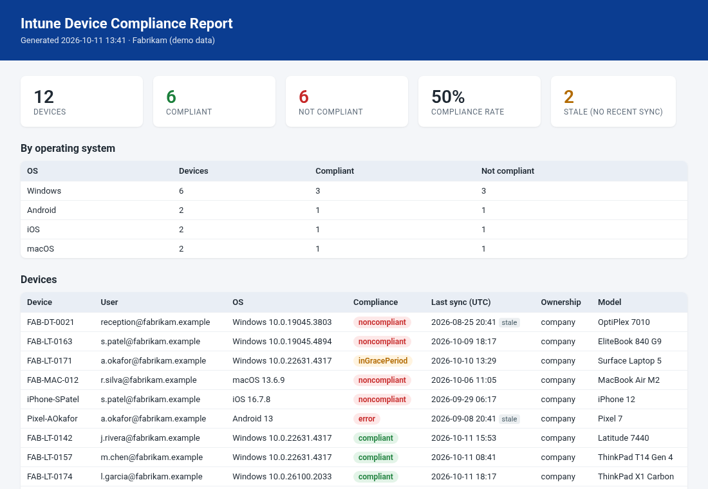

# Intune Toolkit

PowerShell toolkit for everyday Microsoft Intune work, built on **Microsoft Graph**:

| Module | What it does |
|---|---|
| **Compliance report** (`Get-IntuneComplianceReport.ps1`) | Exports every managed device and its compliance state to **CSV** plus a clean **HTML report** you can send to a client |
| **Win32 app packaging** (`IntuneWin32App.psm1`) | Wraps Microsoft's **IntuneWinAppUtil.exe** and **uploads the .intunewin to Intune** through Graph: app creation, chunked Azure blob upload, commit |
| **Autopilot** (`IntuneAutopilot.psm1`) | Collects **hardware hashes** (RMM-friendly, appends to a shared CSV) and **imports** them into Autopilot with status tracking |



## The problem

- **Compliance:** exporting from the admin center and building a summary in Excel takes time, once per tenant, every month.
- **App packaging:** each Win32 app means running IntuneWinAppUtil, then clicking through the portal wizard to upload it, type the commands and add detection rules. That's slow, error-prone and hard to repeat.
- **Autopilot:** getting hashes off new PCs and into Intune usually means USB sticks, `Get-WindowsAutopilotInfo` one device at a time, and manual CSV uploads.

## Features

**Compliance report**
- All devices, with automatic paging and retry/back-off on throttling (HTTP 429/503/504)
- Filter by **OS** and **non-compliant only**, and flag **stale** devices (no sync in N days)
- Self-contained HTML (summary cards, per-OS breakdown, device table), output HTML-encoded
- Read-only

**Win32 apps**
- `Get-IntuneWinAppUtil` downloads the official tool from Microsoft's GitHub
- `New-IntuneWinPackage` runs it quietly, validates inputs and checks the output
- `Get-IntuneWinPackageInfo` reads `Detection.xml` (sizes, encryption info, MSI product code)
- `New-IntuneWin32DetectionRule` builds MSI product-code, file and registry detection rules
- `Publish-IntuneWin32App` creates the app, uploads the content in blocks, commits it and sets the content version. MSI packages get a product-code detection rule automatically. Standard return codes (0/1707/3010/1641/1618) are included. Supports `-WhatIf`

**Autopilot**
- `Get-AutopilotHardwareHash` reads the hash locally (no extra modules needed), writes the exact CSV format Intune expects, skips duplicate serials, and suits a one-line RMM job
- `Import-AutopilotDevice` validates each row (missing or non-base64 hashes), imports it, polls until each device is `complete` or `error` (e.g. `ZtdDeviceAlreadyAssigned`), can override the group tag, can trigger an Autopilot sync, and supports `-WhatIf`

**Engineering:** comment-based help on every function, parameter validation, error handling, logging, Pester tests with Graph and blob storage mocked, PSScriptAnalyzer-clean, GitHub Actions CI.

## Time saved

Estimates per job:

| Job | Manual | With the toolkit |
|---|---|---|
| Monthly compliance report, per tenant | 30-60 min | under 1 min, schedulable |
| Package + upload a Win32 app | 15-20 min of clicking | about 1 min, repeatable script |
| Register 25 new PCs in Autopilot | 1-2 h | about 10 min (RMM collects, one import) |

## Requirements

- PowerShell **7.0+**
- `Install-Module Microsoft.Graph.Authentication -Scope CurrentUser`
- Windows for `New-IntuneWinPackage` (IntuneWinAppUtil is a Windows tool) and `Get-AutopilotHardwareHash` (run elevated). Everything else is cross-platform.

## Permissions needed

| Feature | Microsoft Graph permission |
|---|---|
| Compliance report | `DeviceManagementManagedDevices.Read.All` |
| Win32 app upload | `DeviceManagementApps.ReadWrite.All` |
| Autopilot import / sync | `DeviceManagementServiceConfig.ReadWrite.All` |

Delegated (an Intune Administrator signs in) or app-only (app registration with a certificate, which is recommended for automation).

## Usage

```powershell
Import-Module ./IntuneToolkit.psd1
Connect-ICRGraph -TenantId contoso.onmicrosoft.com                       # delegated
# Connect-ICRGraph -TenantId $tid -ClientId $appId -CertificateThumbprint $thumb   # app-only
```

### Compliance report

```powershell
./Get-IntuneComplianceReport.ps1 -TenantId contoso.onmicrosoft.com
./Get-IntuneComplianceReport.ps1 -TenantId contoso.onmicrosoft.com -OperatingSystem Windows -NonCompliantOnly -StaleDays 14
./Get-IntuneComplianceReport.ps1 -TenantId $tid -ClientId $appId -CertificateThumbprint $thumb -TenantName 'Contoso Ltd' -OutputPath D:\Reports\Contoso
./examples/New-SampleReport.ps1     # preview with fake data, no tenant needed
```

### Win32 app: package and publish

```powershell
$tool = Get-IntuneWinAppUtil -Path C:\Packaging\tools
$pkg  = New-IntuneWinPackage -SourceFolder C:\Packaging\7zip\source -SetupFile 7z2408-x64.msi -OutputFolder C:\Packaging\7zip\out -ToolPath $tool

# MSI: detection rule is created automatically from the product code
Publish-IntuneWin32App -Path $pkg.FullName -DisplayName '7-Zip 24.08 (x64)' -Publisher 'Igor Pavlov' `
    -InstallCommandLine 'msiexec /i "7z2408-x64.msi" /qn' -UninstallCommandLine 'msiexec /x {23170F69-40C1-2702-2408-000001000000} /qn'

# EXE: supply a detection rule
$rule = New-IntuneWin32DetectionRule -Path 'C:\Program Files\Contoso\Agent' -FileOrFolderName 'agent.exe'
Publish-IntuneWin32App -Path .\out\setup.intunewin -Publisher 'Contoso' -InstallCommandLine 'setup.exe /S' `
    -UninstallCommandLine '"C:\Program Files\Contoso\Agent\uninstall.exe" /S' -DetectionRule $rule -WhatIf
```

Full script: [`examples/Deploy-7Zip.example.ps1`](examples/Deploy-7Zip.example.ps1).

### Autopilot

```powershell
# On each new PC (elevated / RMM as SYSTEM): append to a shared CSV
Get-AutopilotHardwareHash -OutputCsv '\\fs01\it$\autopilot\fabrikam.csv' -GroupTag 'Fabrikam-Standard'

# From your admin workstation: dry run, then import and sync
Import-AutopilotDevice -CsvPath '\\fs01\it$\autopilot\fabrikam.csv' -WhatIf
Import-AutopilotDevice -CsvPath '\\fs01\it$\autopilot\fabrikam.csv' -Sync | Format-Table
```

## Sample output

- Compliance: [`sample-report.csv`](examples/sample-report.csv), [`sample-report.html`](examples/sample-report.html), screenshot above
- Win32 upload and Autopilot import console output: [`sample-publish-output.txt`](examples/sample-publish-output.txt)
- Autopilot CSV format: [`sample-autopilot-hashes.csv`](examples/sample-autopilot-hashes.csv)

All sample data (devices, users, serials, hashes, IDs) is fictitious.

## Project layout

```text
IntuneToolkit.psd1                 module manifest (imports all three modules)
Get-IntuneComplianceReport.ps1     compliance report entry script
src/IntuneComplianceReport.psm1    Graph paging, filtering, summary, HTML
src/IntuneWin32App.psm1            IntuneWinAppUtil wrapper + Graph/blob upload
src/IntuneAutopilot.psm1           hardware hash collection + Autopilot import
tests/                             Pester tests (Graph, blob storage, CIM, tool mocked)
examples/                          sample outputs (fake data) and example scripts
```

## Running the tests

```powershell
Invoke-Pester ./tests -Output Detailed
Invoke-ScriptAnalyzer -Path . -Recurse -Settings ./PSScriptAnalyzerSettings.psd1
```

## Roadmap ideas

- Per-policy failure reasons in the compliance report
- App assignments (required/available groups) in `Publish-IntuneWin32App`
- Supersedence and dependencies for Win32 apps
- Multi-tenant (GDAP) loop for MSPs

## License

MIT, see [LICENSE](LICENSE).
